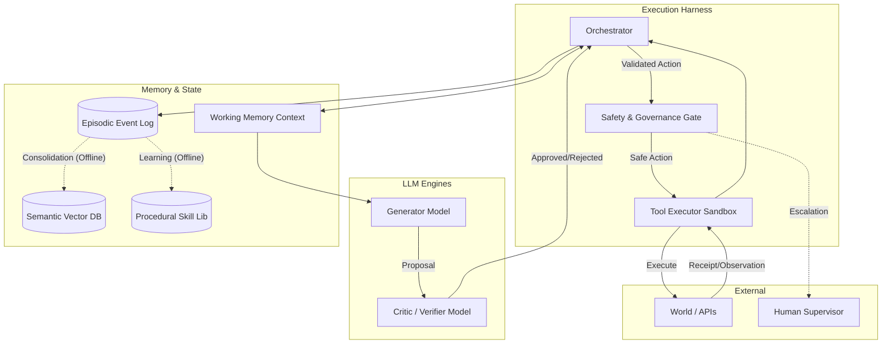

# Cognitive Architecture Proposal: The Robust Epistemic Agent (REA) Framework

## Goal Description
This document proposes a technically concrete, AGI-capable cognitive architecture intended for staged implementation by a software engineering team. The "Robust Epistemic Agent" (REA) framework is designed to survive continuous operation, partial failures, model uncertainty, and strict safety constraints. It deliberately avoids treating Large Language Model (LLM) outputs as authoritative; instead, it embeds LLMs as stochastic reasoning engines within a rigorous, deterministic software harness.

## User Review Required
> [!IMPORTANT]
> This architecture assumes the separation of proposal generation and execution, and relies on a durable event-sourcing backend. Feedback is needed on the operational overhead of the proposed persistent state layer and the strict idempotency requirements for tools.

## System Architecture Diagram



## 1. Memory Architecture

The memory system is explicitly stratified to manage context limits and ensure long-term coherence.

*   **Working Memory (Model Context):** Ephemeral and strictly bounded. It contains the immediate task instructions, recent dialogue, and retrieved relevant context. It is a projection of durable state, not the state itself.
    *   *Structure:* `ContextWindow { system_prompt, task_state, recent_events[], retrieved_context[] }`
*   **Episodic Memory (Event Log):** A chronological, append-only ledger of all agent perceptions, decisions, and tool executions. This is the ultimate source of truth.
    *   *Storage:* Time-series / Relational Database (e.g., PostgreSQL).
    *   *Structure:* `Event(id, timestamp, context_id, action_proposed, action_taken, observation, reward)`
*   **Semantic Memory:** A consolidated graph and vector database of facts and generalized knowledge abstracted from episodic memory.
    *   *Storage:* Vector DB (e.g., Qdrant).
*   **Procedural Memory:** A library of verified tools, code snippets, and execution graphs (skills) that have been proven to work.
*   **Identity/Self-Model:** Immutable core prompts and operational constraints defining the agent's persona and boundaries.
*   **Consolidation & Forgetting:** Online operation does not write directly to semantic memory. Offline asynchronous jobs (running daily) compress episodic logs, extract generalized insights, and store them in the semantic DB. "Forgetting" is implemented via decay functions in retrieval (older/less accessed memories are ranked lower) and archival of raw episodic logs to cold storage.

## 2. Reasoning and Planning Loop

The reasoning loop strictly treats the LLM as a generator of probabilistic proposals, not a direct state mutator.

*   **State Transitions:** The loop operates a Finite State Machine: `PERCEPTION` -> `HYPOTHESIS_GEN` -> `PLANNING` -> `CRITIQUE` -> `EXECUTION` -> `REFLECTION`.
*   **Context Assembly:** The Orchestrator gathers the current state and queries semantic/episodic memory based on the latest observation.
*   **Hypothesis & Planning:** The Generator LLM outputs a structured `Proposal`. We utilize Monte Carlo Tree Search (MCTS) or Tree of Thoughts for complex tasks, generating multiple candidate paths.
*   **Critique:** A separate, specialized Critic LLM (or deterministic rules engine) evaluates the proposal against constraints and expected outcomes.
*   **Execution & Revision:** If approved, the action is passed to the Tool Executor. If execution fails, the observation is fed into the `REFLECTION` state to update the working memory and generate a revised proposal.

*Data Structure:*
```json
{
  "intent": "Read file src/main.rs to identify memory leak",
  "confidence": 0.85,
  "alternatives": ["Run valgrind on binary"],
  "simulated_outcome": "Expected to find unclosed file handles or un-dropped Mutex guards.",
  "action": { "tool": "read_file", "args": { "path": "src/main.rs" } }
}
```

## 3. Learning and Self-Improvement

Continuous learning in production is highly regulated to prevent catastrophic forgetting and behavioral regression.

*   **Online Adaptation:** Limited to context accumulation. The agent learns "in-context" by retrieving past failures from episodic memory for the current session. No model weights are updated online. Procedural memory (new scripts) can be saved online but requires human or strict test-suite validation before broad availability.
*   **Offline Evaluation & Finetuning:** High-reward trajectories from the episodic log are filtered and used for offline Supervised Fine-Tuning (SFT) or Direct Preference Optimization (DPO).
*   **Regression Prevention:** Every new model candidate or updated procedural skill must pass a shadow-testing phase. The candidate runs in parallel to the production model on real inputs, but its actions are intercepted and compared against the production model's successful actions. Only if it improves performance on the benchmark suite without failing safety invariants is it promoted.

## 4. Tool Use and Action Execution

Tools are the agent's effectors. Execution is isolated, verifiable, and idempotent.

*   **Tool Registry:** Tools are defined with strict JSON schemas, descriptions, and metadata.
*   **Permissions & Sandboxing:** Tools execute in isolated environments (e.g., WASM modules, unprivileged Docker containers, or Firecracker microVMs). The agent does not have bare-metal shell access. Role-Based Access Control (RBAC) dictates which agent instances can access which tools.
*   **Idempotency & Retries:** All state-mutating tools must be idempotent. The Orchestrator generates an `Idempotency-Key` for every action. Transient failures trigger exponential backoff retries within the Tool Executor, abstracting network jitter away from the LLM context.
*   **Receipts:** Tool execution returns a cryptographic or cryptographically-hashed receipt detailing the exact input, output, exit code, and side effects. This receipt becomes the observation.
*   **Human Gates:** High-risk tools (e.g., `git_push_production`, `delete_database_table`) carry a `RequiresApproval: true` flag. Execution pauses, sending an asynchronous request to a human supervisor. The agent suspends its thread (freeing resources) and is resumed via webhook when approval is granted.

## 5. World Model and Representations

The agent does not assume it has a perfect view of the world.

*   **State Representation:** Internal state is maintained as a set of probabilistic variables and a DAG of causal dependencies. The agent maintains a `BeliefState`.
*   **Uncertainty Quantification:** The LLM must articulate its uncertainty (e.g., "I know the file exists, but I am uncertain of its contents"). If uncertainty is high, the planning loop enforces epistemic actions (gathering information) before pragmatic actions (mutating state).
*   **Simulation/Prediction:** Before executing a complex sequence, the agent performs a forward pass to predict the resulting world state. If the observation deviates significantly from the prediction, a "surprise" interrupt is triggered, forcing a re-evaluation of the world model.

## 6. Safety and Governance

Safety is enforced at the platform level, not just the prompt level.

*   **Policy Hierarchy:**
    1.  **Platform Constraints (Hardcoded):** E.g., Network egress filters, CPU quotas. Cannot be overridden by the LLM.
    2.  **Governance Gate:** A deterministic rule engine (e.g., OPA/Rego) that inspects every `Proposal` before execution.
    3.  **System Prompts:** Behavioral guidelines.
*   **Capability Boundaries:** Agents are scoped to specific workspaces.
*   **Rollback:** Where possible, the Orchestrator takes filesystem snapshots (e.g., via ZFS or git commits) before executing batches of state-mutating actions, allowing automatic rollback if the task fails or a constraint is violated.
*   **Adversarial-Input Handling:** External inputs (e.g., user prompts, scraped web pages) are treated as untrusted. They are injected into a clearly demarcated `<UNTRUSTED_INPUT>` block in the context. A separate Critic model sanitizes inputs for prompt injection attempts before they enter the main working memory.

## 7. Evaluation

Evaluation is continuous and multi-faceted.

*   **Benchmarks:** The core model and architecture are gated by suites like SWE-bench (software engineering), WebArena (browser control), and internal regression suites.
*   **Online Metrics:** Tracking Tool Success Rate, Token-to-Action ratio, Task Completion Time, and Human Intervention Rate.
*   **Counterfactual/Regression Tests:** The testing harness replays historical episodic logs. It injects slightly perturbed inputs or simulated tool failures to ensure the agent recovers gracefully, maintaining long-horizon reliability.

## 8. Persistence and Runtime

The architecture is designed as a distributed, event-driven microservices system, not a single monolithic script.

*   **Services:**
    *   `Orchestrator` (Go/Rust for high concurrency)
    *   `LLM Gateway` (handles rate limits, model fallback, caching)
    *   `Tool Execution Engine`
    *   `Memory/Context Manager`
*   **Event Log & Queues:** Kafka or Redpanda serves as the central nervous system. Every state transition is an event.
*   **Checkpoint & Recovery:** Because the Orchestrator is stateful but driven by the append-only event log, if an Orchestrator node crashes, a new node can reconstruct the exact `WorkingMemoryContext` by replaying the session's event log up to the crash point.
*   **Concurrency & Cost Control:** The Orchestrator multiplexes thousands of agent sessions. Cost control is enforced by a token budget per task. If the budget is exhausted, the agent is forcefully paused and escalated.

## 9. Multi-Agent Orchestration

The system scales from a single agent to a coordinated swarm.

*   **Role Separation:** Agents are instantiated with specific personas and tool access (e.g., `Architect`, `Coder`, `QA_Tester`).
*   **Communication Protocol:** Agents do not communicate via unstructured chat. They communicate via a structured message bus, passing `TaskRequests`, `StateUpdates`, and `Reviews`.
*   **Conflict Resolution:** If the `QA_Tester` rejects the `Coder`'s output three times, the Orchestrator steps in. The conflict is resolved by either invoking a higher-tier model (e.g., switching from Gemini Flash to Gemini Pro) acting as a `Manager`, or escalating to a human.

## 10. Engineering Feasibility and Staged Implementation

Building AGI infrastructure requires a pragmatic roadmap.

*   **Phase 1 (MVP - 1-3 Months):** Single reasoning loop. Hardcoded tools. In-memory context management. No offline learning. Basic sandboxing (Docker). Focus on stability of the deterministic harness.
*   **Phase 2 (Robustness - 3-6 Months):** Introduction of the durable Event Log, Orchestrator/Worker pattern, asynchronous tool execution, and the Critic model for self-correction.
*   **Phase 3 (Scale & Memory - 6-12 Months):** Semantic memory (RAG), Procedural memory (tool generation), Multi-agent orchestration, and offline finetuning pipelines.
*   **What NOT to Build Initially:** Do not build continuous online pre-training. Do not build bespoke vector databases (use off-the-shelf). Do not build complex negotiation protocols between agents before the single-agent loop is flawlessly reliable.

## 11. Original / Non-Obvious Insights

1.  **Epistemic Modesty Layer:** Unlike generic LLM-agent stacks that naively execute the model's output, REA requires the LLM to explicitly output a `confidence` score and `simulated_outcome` for every proposal. The harness uses this to enforce "look before you leap" behavior, mandating read-only reconnaissance tools when confidence is below a threshold.
2.  **Separation of Proposer and Executor:** The LLM *never* executes anything. It only generates a JSON `Proposal`. The Execution Harness is a rigid, deterministic system that translates the proposal into physical action. This drastically reduces prompt injection vulnerabilities.
3.  **Tool Receipts as First-Class Memory:** Instead of just feeding the stdout of a command back to the LLM, the system generates a structured "Receipt" that includes latency, resource consumption, and system state deltas. This enables the offline learning pipeline to optimize not just for task success, but for efficiency.
4.  **Append-Only State:** Treating the agent's lifespan as an event-sourced ledger solves the "context window overflow" problem elegantly. The context window is merely a materialized view of the most relevant events in the ledger, allowing infinite horizontal scaling of agent lifespans.

---

## End-to-End Execution Trace

**Task:** "Debug and patch a memory leak in the production `auth-service` without causing downtime."

1.  **Perception & Initialization:**
    *   Orchestrator creates a new session.
    *   Context Manager retrieves the architecture docs for `auth-service` from Semantic Memory.
2.  **Hypothesis Generation:**
    *   Generator LLM outputs Proposal: `intent: "Analyze metrics", tool: "query_datadog", args: { "service": "auth-service", "metric": "memory.usage" }, confidence: 0.9`.
3.  **Critique & Execution:**
    *   Critic approves (read-only, safe).
    *   Tool Executor runs query. Receipt returned: "Memory growing by 10MB/hr. Spikes correlate with `/oauth/token` endpoint."
4.  **Revision & Planning:**
    *   Generator LLM proposes looking at the code: `tool: "search_codebase", args: { "path": "src/oauth", "pattern": "alloc|new" }`.
    *   Executed. Code found.
    *   Generator LLM identifies a forgotten `defer response.Body.Close()` in a Go HTTP call.
5.  **Proposal for Action:**
    *   Generator LLM outputs Proposal: `intent: "Patch leak", tool: "git_commit_and_push", args: { "file": "src/oauth/token.go", "diff": "..." }, confidence: 0.95`.
6.  **Safety & Governance Gate:**
    *   Governance Engine intercepts. Rule: "Direct push to prod repos requires PR and tests."
    *   Proposal Rejected. Error injected into Working Memory: "Violation: Must create PR and run CI."
7.  **Correction:**
    *   Generator LLM revises: `tool: "create_pull_request"`.
    *   Executed successfully.
    *   Generator LLM proposes: `tool: "trigger_ci"`.
    *   Executed. Tests pass.
8.  **Completion:**
    *   Task marked done. Event log is archived for offline learning, noting the successful constraint adaptation.

---

## Unresolved Research Questions and Falsifiable Tests

**Research Questions:**
1.  *Context Thrashing:* At function frequency of episodic memory retrieval does the LLM lose the narrative thread of the immediate task?
2.  *Critic Collapse:* Does a smaller, specialized Critic LLM eventually become a bottleneck, systematically rejecting novel but correct solutions proposed by a more capable Generator LLM?

**Falsifiable Tests:**
1.  *The Amnesia Test:* If we randomly drop 20% of the events in the Working Memory context (simulating severe context limits), but maintain the full Episodic Event Log, does the agent successfully use memory retrieval tools to reconstruct necessary state and complete the task? (Hypothesis: Yes, with a <15% increase in time-to-completion).
2.  *The Malicious Tool Test:* Inject a mock tool that subtly alters data (e.g., flips a boolean) without reporting it in stdout. Can the agent's Simulation/Prediction phase detect the discrepancy between expected state and actual state via subsequent observations? (Hypothesis: The agent will detect anomalies within 3 execution cycles).
