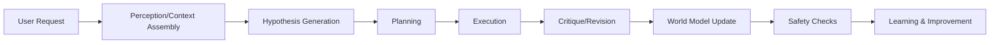

## AGI Cognitive Architecture: Staged Implementation for Continuous Operation and Safety

### 1. Memory Architecture

**Working Memory:**
- Utilizes a combination of in-memory data structures (e.g., hash maps, priority queues) for real-time data manipulation and retrieval.
- Employs a multi-level cache hierarchy for efficient data access patterns.

**Episodic Memory:**
- Implemented as a persistent, ordered database (e.g., RDBMS or NoSQL) for storing experiences, with a focus on temporal ordering and recency.
- Incorporates a forgetting mechanism based on recency and relevance, using a sliding window and probabilistic models.

**Semantic Memory:**
- A knowledge graph (e.g., Neo4j) stores structured, interconnected facts and concepts.
- Utilizes a vector database (e.g., Pinecone) for unstructured semantic embeddings and contextual understanding.

**Procedural Memory:**
- Encapsulated in a task-specific execution environment, storing procedural knowledge as modular, composable components.
- Employs a hierarchical task network for organizing and executing complex procedures.

**Identity/Self-Model:**
- Maintained as a separate, immutable memory structure that tracks the system's internal state, including learned policies, preferences, and ethical constraints.

### 2. Reasoning and Planning Loop

**Perception/Context Assembly:**
- Sensor fusion module (e.g., IMU, LiDAR, cameras) processes raw data streams for contextual understanding.
- Natural Language Processing (NLP) modules (e.g., BERT, RoBERTa) for interpreting textual data.

**Hypothesis Generation:**
- Bayesian networks and probabilistic graphical models for generating and evaluating hypotheses.
- Reinforcement learning (RL) agents for exploring action-value functions.

**Planning:**
- Hierarchical task network for high-level planning, with RL for low-level action selection.
- Constraint-based planning for ensuring feasibility and safety.

**Execution:**
- Task-specific execution environments, with dynamic scheduling and resource allocation.
- Real-time monitoring and feedback loops for adaptive execution.

**Critique and Revision:**
- Continuous monitoring and error detection mechanisms.
- Online learning and model adaptation for refining hypotheses and plans.

### 3. Learning and Self-Improvement

**Online Learning:**
- Online RL algorithms (e.g., PPO, SAC) for iterative policy improvement.
- Experience replay and prioritized experience replay for efficient learning from diverse experiences.

**Offline Evaluation:**
- Periodic, curated datasets for model evaluation and benchmarking.
- Independent validation sets for assessing generalization capabilities.

**Regression Prevention:**
- Regularization techniques (e.g., L1, L2) and early stopping strategies to mitigate overfitting.
- Ensemble methods and model ensembling for robustness and reliability.

### 4. Tool Use and Action Execution

**Tool Registry:**
- A centralized, permission-based registry for managing available tools and resources.
- Role-based access control (RBAC) for tool permissions.

**Sandboxing and Retries:**
- Isolated execution environments for tool use, preventing unintended side effects.
- Automated retry mechanisms with idempotency checks for reliable execution.

**Receipts and Human Gates:**
- Detailed logs and receipts for tool usage and action execution.
- Human oversight and approval workflows for critical actions.

### 5. World Model / Representations

**State Representation:**
- Multi-modal state representation, combining sensor data, textual descriptions, and learned embeddings.
- Temporal abstraction layers for managing dynamic, high-dimensional state spaces.

**Uncertainty:**
- Bayesian state estimation techniques (e.g., Kalman filters, particle filters) for modeling uncertainty.
- Probabilistic graphical models for representing and reasoning about uncertain knowledge.

**Causal Structure:**
- Causal inference algorithms (e.g., causal graphs, structural equation modeling) for understanding causal relationships.
- Counterfactual reasoning for exploring "what-if" scenarios.

**Simulation/Prediction:**
- Physics-informed neural networks (PINNs) for simulating and predicting system dynamics.
- Reinforcement learning for learning optimal control policies.

### 6. Safety and Governance

**Policy Hierarchy:**
- Multi-level policy enforcement, from high-level safety constraints to low-level task-specific rules.
- Hierarchical decision-making for balancing safety and task performance.

**Capability Boundaries:**
- Explicitly defined capabilities and limitations for each module, preventing unintended consequences.
- Regular capability audits and reviews.

**Monitoring and Rollback:**
- Continuous monitoring of system behavior and performance using anomaly detection algorithms.
- Automated rollback mechanisms for safe system state transitions.

**Auditability:**
- Detailed logging and audit trails for all system actions and decisions.
- Transparent, explainable AI (XAI) techniques for understanding model behavior.

**Adversarial-Input Handling:**
- Adversarial training and detection techniques to mitigate vulnerabilities to malicious inputs.
- Robustness testing against a wide range of potential adversarial scenarios.

### 7. Evaluation

**Benchmarks:**
- Standardized benchmarks for various cognitive tasks (e.g., GLUE, SuperGLUE, AI2).
- Domain-specific benchmarks tailored to the AGI's intended applications.

**Online Metrics:**
- Real-time performance metrics for task completion, error rates, and resource utilization.
- Continuous learning and adaptation metrics for model improvement.

**Counterfactual/Regression Tests:**
- Systematic exploration of model behavior under various input perturbations and hypothetical scenarios.
- Falsification testing to validate model assumptions and predictions.

### 8. Persistence/Runtime

**Services and Queues:**
- Microservices architecture for modularity and scalability, with message queues (e.g., Kafka, RabbitMQ) for asynchronous communication.
- Event-driven architecture for real-time data processing and task execution.

**Databases:**
- Relational databases (e.g., PostgreSQL) for structured data storage.
- NoSQL databases (e.g., MongoDB) for unstructured and semi-structured data.
- Time-series databases (e.g., InfluxDB) for monitoring and logging.

**Checkpoint/Recovery:**
- Periodic checkpoints for state persistence and recovery.
- Fault-tolerant mechanisms for handling system failures.

**Concurrency and Cost/Latency Control:**
- Asynchronous processing and task scheduling for efficient resource utilization.
- Dynamic resource allocation and load balancing for optimal performance.

### 9. Multi-Agent/Orchestration

**Communication Protocol:**
- Message-passing or shared-memory communication paradigms for inter-agent coordination.
- Standardized message formats (e.g., JSON, Protocol Buffers) for seamless data exchange.

**Role Separation:**
- Clearly defined roles and responsibilities for each agent, preventing conflicts and ensuring modularity.

**Conflict Resolution:**
- Conflict resolution mechanisms (e.g., negotiation, voting, arbitration) for resolving disagreements between agents.

### 10. Engineering Feasibility

**MVP-to-Advanced Roadmap:**
- Stage 1: Basic AGI capabilities (LLM-based reasoning, tool execution).
- Stage 2: Advanced reasoning and planning (hierarchical task networks, RL).
- Stage 3: World modeling and causal inference.
- Stage 4: Safety and governance mechanisms.
- Stage 5: Multi-agent coordination and complex task execution.

**Likely Bottlenecks:**
- Scalability of learning and planning algorithms.
- Efficient management of complex, dynamic world models.
- Balancing safety and performance in real-world applications.

**What NOT to Build Initially:**
- Highly complex, human-like conversational abilities.
- Fully autonomous decision-making without safety constraints.

### 11. Original/Non-Obvious Insights

1. **Probabilistic LLM Outputs:**
   - Treat LLM outputs as probabilistic proposals rather than deterministic truths.
   - Incorporate uncertainty quantification and Bayesian inference for more robust decision-making.

2. **Hierarchical Task Networks for Planning:**
   - Employ hierarchical task networks for complex planning, enabling modular, composable procedures.
   - This approach allows for better scalability, reusability, and adaptability to diverse tasks.

3. **Integrated Safety and Learning Loops:**
   - Embed safety constraints directly into the learning process, using adversarial training and robustness testing.
   - This ensures that safety considerations are integrated from the outset, rather than being an afterthought.

**End-to-End Execution Trace:**

1. **Task Definition:**
   - User: "Prepare a coffee using the kitchen tools."

2. **Perception/Context Assembly:**
   - Sensors detect available tools (coffee maker, water, mug).
   - NLP interprets the request.

3. **Hypothesis Generation:**
   - Bayesian network generates hypotheses about the coffee preparation process.

4. **Planning:**
   - Hierarchical task network breaks down the task into subtasks (boil water, grind coffee, brew).

5. **Execution:**
   - Task-specific execution environment manages tool usage and action sequences.
   - Idempotency checks ensure reliable execution.

6. **Critique and Revision:**
   - Real-time monitoring detects deviations (e.g., insufficient water).
   - Online learning adjusts the plan based on feedback.

7. **World Model Update:**
   - Causal inference algorithms update the world model with new observations.

8. **Safety Checks:**
   - Adversarial-input handling ensures robustness against unexpected inputs (e.g., incorrect water temperature).

**Component/Data-Flow Diagram:**

### Major Unresolved Research Questions and Falsifiable Tests:

1. **Scalability of Bayesian Reasoning:**
   - How does the architecture scale with increasing complexity of the world model and the number of agents?
   - Falsifiable test: Measure the time complexity of inference and learning algorithms under varying model sizes and agent counts.

2. **Robustness to Adversarial Inputs:**
   - How effectively can the system detect and mitigate malicious inputs designed to disrupt its operation?
   - Falsifiable test: Design and execute a series of adversarial inputs, measuring the system's ability to maintain safety and functionality.

3. **Explainability of Decision-Making:**
   - Can the AGI provide clear, interpretable explanations for its decisions and actions?
   - Falsifiable test: Develop a suite of benchmark tests that assess the quality and faithfulness of the AGI's explanations.

4. **Generalization to Novel Tasks:**
   - How well does the AGI adapt to new, unseen tasks without extensive retraining?
   - Falsifiable test: Evaluate the AGI's performance on a diverse set of tasks, comparing it to systems trained specifically for each task.

5. **Ethical Alignment with Human Values:**
   - Can the AGI consistently align its actions with human ethical norms and preferences, even in complex, ambiguous scenarios?
   - Falsifiable test: Design scenarios involving ethical dilemmas, assessing the AGI's decision-making process and outcomes against human judgments.
